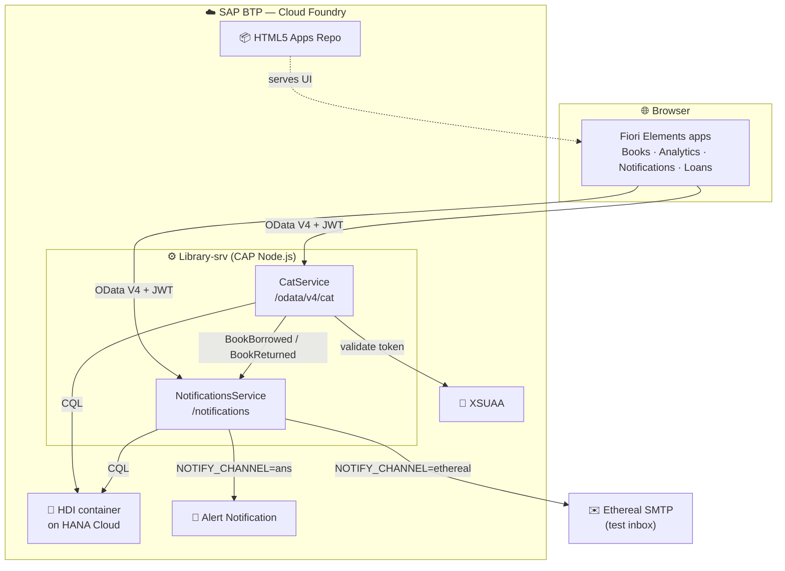

# 📚 Library — I built every layer of SAP BTP so you don't have to guess if I know it

> Data model → OData API → business logic → events → Fiori UI → HANA → auth → Cloud Foundry.
> One repo. One dev. Zero tutorial copy-paste.

[](https://cap.cloud.sap)
[](https://www.odata.org)
[](https://experience.sap.com/fiori-design)
[](https://www.sap.com/products/hana.html)
[](https://www.sap.com/products/technology-platform.html)

---

## 🎯 ok so what is this

It's a library app. Sounds basic. It's not.

- **Librarians** run the catalog: restock, drop time-boxed discounts, log borrows and returns.
- **Every borrow/return fires an event.** A separate service catches it and sends notifications (in-app + email). The catalog has no idea notifications even exist. That's the point.
- **Analysts** get a stock-by-genre dashboard.
- **~1,000 real books, 592 real authors**, with real titles, prices, genres and cover art. No `Book 1`, `Book 2` energy here.

Deployed and tested on SAP BTP (trial, so it's not up 24/7). Runs on your laptop with **zero** BTP account.

**Why tho?** I'm a SAPUI5/Fiori dev. I was tired of only knowing the UI layer, so I built everything underneath it myself.

**Start here 👉** [Architecture](docs/02-architecture.md) · [Code tour](docs/03-code-tour.md) · [Deploy it yourself](docs/04-deploy-from-scratch.md)

---

## 🏗️ how it's wired



**tl;dr of the flow**
- The UI talks **OData V4** to one CAP app that runs two services.
- No valid **XSUAA** token means no entry (401). Every request gets checked.
- **CatService** handles the catalog and lending, and fires events when a book is borrowed or returned.
- **NotificationsService** picks those events up, writes the notification rows, and delivers them. One env var decides where they go: the Ethereal test inbox locally, SAP Alert Notification on BTP.
- All the data lives in a **HANA HDI container**. Locally it's in-memory SQLite, same code.

Full layer-by-layer breakdown, request flows and design trade-offs: [`docs/02-architecture.md`](docs/02-architecture.md)

---

## 🧱 what's inside

| Layer | Stack | What it actually does |
|---|---|---|
| **Data model** | CDS on HANA Cloud (HDI) | Catalog, pricing, lending + a separate notifications domain. Aspects, enums, compositions, many-to-many, calculated fields, views |
| **API** | OData V4 via CAP | Two services. CRUD for free, plus bound/unbound actions and read-only functions |
| **Logic** | CAP Node.js handlers | Validation, discounts, `effectivePrice`, borrow/return rules |
| **Events** | CAP emit / subscribe | Idempotent consumer, fan-out, delivery tracking |
| **UI** | Fiori Elements (List Report, Object Page, Analytical List Page) | Annotation-driven: cover images, actions, stock-by-genre chart |
| **Auth** | XSUAA | Token-checked API, Viewer/Admin roles |
| **Delivery** | Nodemailer + SAP Alert Notification | One env var flips between test inbox and real alerting |
| **Deploy** | MTA → Cloud Foundry | One `mta.yaml`, one command, every service created |
| **Integration** | SAP Integration Suite (CPI) | Book Enricher iFlow: HTTPS → Request-Reply → external books API. Runs standalone, not called by the CAP app |

---

## 🧠 design calls I'd defend in an interview

- **Discounts never touch `Books.price`.** They're their own rows with a validity window. Reversible, auditable, and no "20% twice = 36% off" bug. `effectivePrice` is computed at read time, so it's always right for *today*. Trade-off: one query per row (N+1). Fine at this scale; batching is the prod move.
- **Events over direct calls.** `borrowBook` just announces what happened. NotificationsService decides what to do with it. Swap or scale either side without touching the other.
- **Idempotency is built in, not vibes.** Every event carries its own `eventId`, and a unique constraint on `RawEvents.eventId` means a redelivered event gets caught and skipped. No duplicate emails.
- **Fan-out + delivery status.** One event → a member row + an admin row, each going `PENDING → SENT / FAILED` with the error saved. Failures are visible and retryable, not silently lost.
- **`NOTIFY_CHANNEL` switch.** Same code: free Ethereal inbox locally, SAP Alert Notification on BTP.
- **`req.params.at(-1)` for bound actions.** Still works when the action is called through a navigation path like `Authors(..)/books(..)/restock`.
- **Data lives in Git.** BTP trial wipes itself regularly. Clone + deploy = full catalog back. Reproducible beats manual imports.
- **Services declared in `mta.yaml`, never created by hand.** One source of truth, zero name clashes.

---

## 📁 repo map

```text
Library/
├── app/
│   ├── list_object_library/      # Books — List Report + Object Page
│   ├── library-analytics/        # Analytical List Page (stock by genre)
│   ├── notifications-ui/         # Notifications + mark-as-read
│   ├── loan-management/          # Loans — borrow/return
│   └── library-overview/         # OVP — kept on purpose as a dead end (see below)
├── db/
│   ├── schema.cds                # Library domain
│   ├── notifications-schema.cds  # Notifications domain
│   └── data/                     # CSV seed data
├── srv/
│   ├── cat-service.cds / .js     # Catalog & lending API + handlers
│   ├── cat-service-ui.cds        # Fiori annotations
│   ├── notification-service.cds / .js   # Event consumer
│   └── lib/                      # mailer.js, ans-client.js (OAuth2 client-credentials)
├── docs/
├── mta.yaml
└── xs-security.json
```

---

## 🚀 run it

### Local — 5 min, no BTP needed
```bash
git clone https://github.com/dhruv37502005/Library.git
cd Library
npm install
npx cds watch
```
Open `http://localhost:4004`. CSVs load into in-memory SQLite. That's it.

### Ship it to BTP
Needs: BTP account, a HANA Cloud instance mapped to your CF space, CF CLI + MultiApps plugin, `mbt`.
```bash
cf login -a https://api.cf.<region>.hana.ondemand.com --sso
mbt build
cf deploy mta_archives/Library_*.mtar
```*`mta.yaml` creates every service. *on't `cf create-service`*anything by hand. Trust.

Full wal*through (incl. role ass*gnment after a trial reset): [`doc*/04-deploy-from-scrat*h.md`](docs/04-deploy-from-*cratch.md)

---

## ⚠️ known limit*tions — keeping*it 💯

<!-- AUTHOR: delete any lin* below that you've*already fixed and pushed. -->

**S*ill cooking**
- Opening*the UIs *on BTP* needs SAP Work Zo*e (wants I*S on trial) or an app router. The *pps are in the HTML5 repo, just no* served yet. Locally they all run.*- SAP Alert Notification is bound *nd proven from the cockpit; trigge*ing it from a CAP handler end to e*d isn't verified yet.
- Events are*in-process. Persistent outbox / SA* Event Mesh is next.
- No automate* tests yet. Big L, it's on the lis*.

**Bugs I found in my own code (*nd know how to fix)**
- `restock` *ith an unknown book ID throws a 50* instead of a clean 404. `req.erro*` doesn't stop execution; it needs*`return req.reject`.
- `getExpensi*eBooks` has a hardcoded threshold *f 300, above every price in the re*l catalog, so it returns nothing.
* `BookReturned` events get logged *s `BookBorrowed`, and return not*fications skip `NOTIFY_CHANNEL`.
-*Seed data: a few `BookCategories` *ows point at*old book IDs, ~11 publish dates ar* in the future (two-digit-*ear parsing), and author `country`*is empty.

**Dead ends that taught*me the most**
- **Overview Page is*OData V2 only.** On V4 it just bre*ks. Kept `library-overview`*as the receipt.
- **Analytical Lis* Page on V4** needs `@Aggregation.*pplySupported` + dyn*mic measures. Classic measures = e*pty chart.
- **Managed Work Zone n*eds IAS + OIDC trust**, which isn'* on trial by default.
- **CP* → external API got rate-limited (*TTP 429)** because the tenant shar*s one outbound IP. Not a config bu*, a platform reality.
- **Joule-ge*erated UIs** land at around 65*. Always review the annotations.

*--

## 🗺️ what's next
1. Close th* bugs above
2. Persistent*outbox → SAP Event Mesh
3. Tool-ca*ling AI agent (Gemini free tier) t*at answers questions*by calling CatService over OData
4* Tests

---

## 🙏 *redits
- **Best Books Ever** publi* dataset: book*and author data
- SAP CAP docs and*samples

## 📜 license
MIT

---

**uilt by **Dhruv Rathore**: a SAPUI*/F*ori dev who wanted to understand e*erything underneath the UI, so I b*ilt every layer myself (model, API* events, auth, database, deploymen*). Every decision here is one I ca* explain and defend. Ask me about *ny line.*