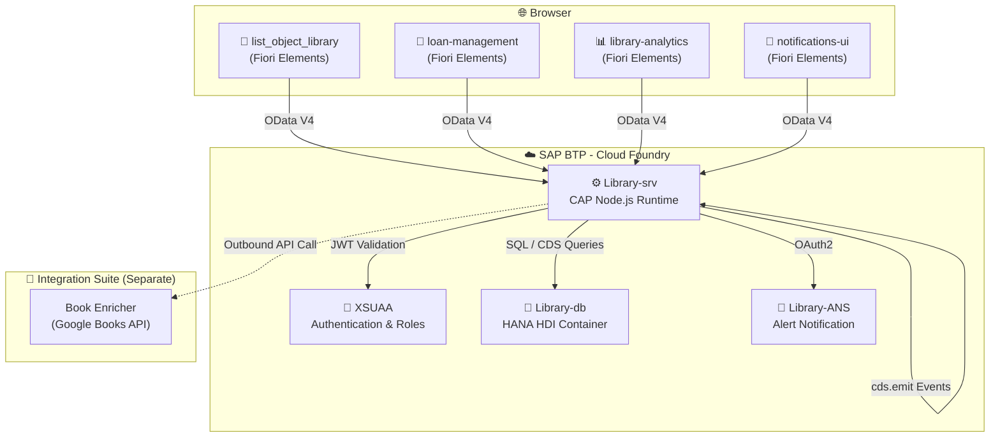

# 📚 Library — A Full-Stack SAP BTP Application

> A production-shaped library management system built on SAP Business Technology Platform.
> **CAP · OData V4 · Fiori Elements · HANA Cloud · XSUAA · CPI · Alert Notification**

[](https://cap.cloud.sap)
[](https://www.odata.org)
[](https://sapui5.hana.ondemand.com)
[](https://experience.sap.com/fiori-design)
[](https://www.sap.com/products/hana.html)
[](https://www.sap.com/products/technology-platform.html)

---

## 🎯 What This Is

A working library system with books, authors, categories, lending, discounts, and notifications. Built end-to-end on SAP BTP — domain model, OData services, Fiori apps, authentication, event-driven notifications, and integration flows. Deployed on Cloud Foundry and running live.

**Why it exists:** I spent 6 months learning the SAP cloud stack. This is the artifact that proves I learned it — not a tutorial clone, but a system with real domain logic, working auth, event-driven architecture, and documented trade-offs.

**Best entry point:** [Architecture →](docs/02-architecture.md) · [Deploy it yourself →](docs/04-deploy-from-scratch.md) · [What I learned →](docs/07-learning-notes.md)

---

## 📸 Screenshots

### Authors & Books Management

*Standard Fiori Elements List Report with integrated cover thumbnails.*

### Object Page & Actions

*Object Page featuring the cover image, dynamic effective pricing, and bound actions.*

### Analytical List Page

*V4 Analytical List Page with DynamicMeasures and aggregated stock visualization.*

### Event-Driven Notifications

*Notification delivery dashboard powered by the CAP in-process outbox.*

### Security Proof

*Terminal curl output proving XSUAA auth is strictly enforced (401 Unauthorized).*

---

## ✅ What's Actually Working

| Layer | Component | Status |
|---|---|---|
| **Backend** | CAP Node.js service (`Library-srv`) | ✅ Deployed, live |
| **Auth** | XSUAA with 2 scopes, 2 role-templates, 2 role-collections | ✅ Enforced (401 on anonymous) |
| **Data** | HANA Cloud HDI container + 1,000+ seeded records | ✅ Live |
| **OData** | V4 services — `CatService` + `NotificationsService` | ✅ Live |
| **Frontend** | 5 Fiori Elements apps built and uploaded | ✅ Uploaded |
| **Events** | In-process Outbox → Notifications fan-out | ✅ Working |
| **Email** | Nodemailer + Ethereal test inbox | ✅ Working |
| **Alerting** | SAP Alert Notification Service (ANS) | ✅ Working |
| **Integration** | CPI iFlow: Hello CPI (JSON transform) | ✅ Working |
| **Integration** | CPI iFlow: Book Enricher (Google Books API) | ⚠️ Rate-limited (429) |
| **Approuter** | Standalone Node.js approuter module | ⚠️ Module built, deploy parked |

Honest list of what's still open: [`docs/06-known-limitations.md`](docs/06-known-limitations.md)

---

## 🏗️ Architecture



Full narrative + component-by-component decisions: [`docs/02-architecture.md`](docs/02-architecture.md)

---

## 🧰 Tech Stack

| Category | Technology |
|---|---|
| **Runtime** | Node.js 20 · SAP Cloud Application Programming Model (CAP) 9.x |
| **Model** | CDS (Core Data Services) — entities, aspects, enums, associations, views |
| **API** | OData V4 (auto-generated from CDS) |
| **Database** | SAP HANA Cloud (HDI container) with CSV seed data |
| **Auth** | XSUAA — scopes, role-templates, role-collections |
| **Frontend** | SAP Fiori Elements (List Report, Object Page, ALP) · SAPUI5 1.149 |
| **Dev Environment** | SAP Business Application Studio (BAS) |
| **Deployment** | Cloud Foundry · MTA build tool (`mbt`) |
| **Integration** | SAP Integration Suite — Cloud Platform Integration (CPI) |
| **Notifications** | SAP Alert Notification Service · Nodemailer (Ethereal for tests) |

---

## ✨ Feature Highlights

### Domain Model (CDS)
- **11 entities** across 3 namespaces (`smart.library`, `smart.library.Lending`, `smart.library.Sales`)
- **Reusable types** — `Price`, `BusinessID`, `StockQty`, enums for `GenreType`, `RecipientType`, `DeliveryStatus`
- **Compositions & associations** with backreferences
- **Calculated elements** — `availability` computed via CDS `case` expression
- **CDS views** — `BooksWithAuthor` join exposed as read-only entity

### Service Layer
- **Bound actions:** `restock`, `applyDiscount` (with cross-field date validation)
- **Unbound actions:** `resetAllStock`, `borrowBook`, `returnBook`
- **Functions:** `getTotalBooks`, `getExpensiveBooks`, `getBookCountByGenre`
- **Virtual fields:** `effectivePrice` computed at read-time from active discounts

### Authorization (XSUAA + CAP)
- **2 scopes:** `Viewer` (read) · `Admin` (full access)
- **Service-level `@requires: 'authenticated-user'`** — blocks anonymous at the front door
- **Entity-level `@restrict`** — read-only vs read-write per entity
- **Action-level `@requires`** — Admin-only for mutations, user-level for borrow/return

### Event-Driven Notifications
- `CatService` emits `BookBorrowed` / `BookReturned` via `cds.emit()` → CAP Outbox
- `NotificationsService` subscribes, applies **idempotency** via `RawEvents.eventId` unique constraint
- **Fan-out** — one event → 2 rows (member + admin)

### Integration (CPI)
- **Hello CPI** — validates the tenant connection with a JSON transform
- **Book Enricher** — fetches cover images from Google Books API (rate-limited on shared trial IP)

---

## 📁 Repository Structure

```text
Library/
├── app/                       # Fiori Elements apps (SAPUI5)
│   ├── list_object_library/   # Books — List Report + Object Page
│   ├── loan-management/       # Loans — borrow/return workflows
│   ├── library-analytics/     # Books — ALP with stock-by-genre chart
│   ├── library-overview/      # OVP (documented dead-end — kept for learning)
│   └── notifications-ui/      # Notifications — delivery status + mark-as-read
├── db/
│   ├── schema.cds             # Library domain model
│   ├── notifications-schema.cds # Notifications domain
│   └── data/                  # CSV seed data (1,000 books, 592 authors, etc.)
├── srv/
│   ├── cat-service.cds|.js    # Main catalog service + custom handlers
│   ├── notification-service.cds|.js  # Event consumer + notifications facade
│   ├── cat-service-ui.cds     # Fiori UI annotations
│   └── lib/                   # mailer.js, ans-client.js
├── docs/                      # 📖 Full documentation (start here)
│   ├── 01-what-and-why.md
│   ├── 02-architecture.md
│   ├── 03-code-tour.md
│   ├── 04-deploy-from-scratch.md
│   ├── 05-cpi-flows.md
│   ├── 06-known-limitations.md
│   └── 07-learning-notes.md
├── mta.yaml                   # Multi-target application descriptor
├── xs-security.json           # XSUAA scopes + role-templates + role-collections
└── package.json
```

---

## 🚀 Quick Start

**Full deploy walkthrough:** [`docs/04-deploy-from-scratch.md`](docs/04-deploy-from-scratch.md)

TL;DR for those already familiar with BTP:

```bash
# In SAP Business Application Studio
git clone https://github.com/dhruv37502005/Library.git
cd Library
cf login -a https://api.cf.<region>.hana.ondemand.com
cf create-service xsuaa application Library-auth -c xs-security.json
cf create-service hana hdi-shared Library-db
cf create-service html5-apps-repo app-host Library-repo-host
# ... (see docs for full service list)
mbt build -t ./mta_archives
cf deploy ./mta_archives/Library_1.0.0.mtar -f
```

**Prerequisites:** BAS (or local Node 20 + `@sap/cds-dk` + `mbt` + Cloud Foundry CLI), an SAP BTP trial subaccount, HANA Cloud instance in the target space.

---

## 📖 Documentation

| # | Doc | For whom |
|---|---|---|
| 01 | [What & Why](docs/01-what-and-why.md) | Everyone — the origin story |
| 02 | [Architecture](docs/02-architecture.md) | Devs reviewing design decisions |
| 03 | [Code Tour](docs/03-code-tour.md) | Devs reading the code |
| 04 | [Deploy from Scratch](docs/04-deploy-from-scratch.md) | Anyone re-building it |
| 05 | [CPI Flows](docs/05-cpi-flows.md) | Integration engineers |
| 06 | [Known Limitations](docs/06-known-limitations.md) | Honest scope boundaries |
| 07 | [Learning Notes](docs/07-learning-notes.md) | Interviewers · future-me |

---

## ⚠️ Known Limitations

This is a **learning project**, not production. Deliberate scope boundaries:

- **Single-tenant XSUAA** (`tenant-mode: dedicated`) — no multi-tenancy
- **No draft-enabled entities** — write operations are immediate, no lock-and-edit
- **Approuter deploy parked** — Fiori apps are uploaded; served via BAS during dev
- **CPI Book Enricher rate-limited** — Google Books API 429 on shared trial IP
- **No automated tests** — OPA5 test skeletons exist but aren't wired
- **Notification recipients are synthesized** — real member emails not in the model
- **No Elasticsearch / audit log beyond RawEvents**

Full breakdown + rationale: [`docs/06-known-limitations.md`](docs/06-known-limitations.md)

---

## 📜 License

MIT — see [LICENSE](LICENSE).

---

## 🙏 Credits

- **Best Books Ever** dataset (Kaggle) — seeded book/author data
- **SAP CAP documentation + samples** — reference patterns
- **BTP Trial community** — for the trial-reset survival guides

---

*Built as a portfolio artifact while transitioning to SAP cloud development. Feedback welcome.*