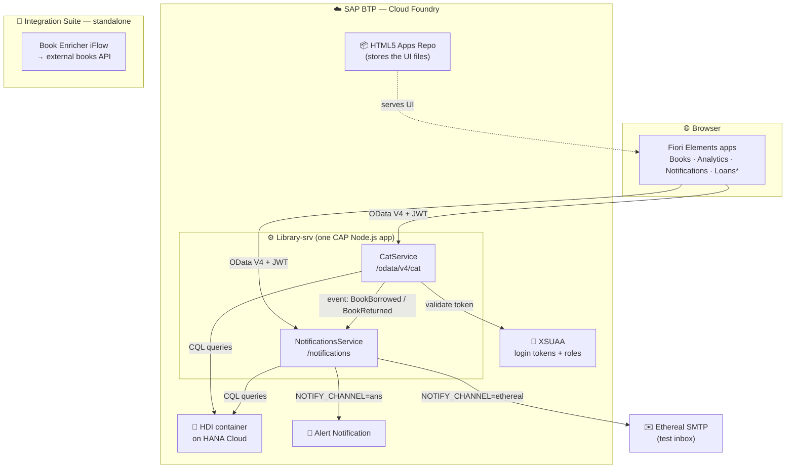

# 📚 Library — A Full-Stack SAP BTP Application

> A library management system built end to end on SAP Business Technology Platform:
> data model, OData services, Fiori apps, authentication, event-driven notifications, and integration.
> **CAP · OData V4 · Fiori Elements · HANA Cloud · XSUAA · MTA · Alert Notification · CPI**

[](https://cap.cloud.sap)
[](https://www.odata.org)
[](https://experience.sap.com/fiori-design)
[](https://www.sap.com/products/hana.html)
[](https://www.sap.com/products/technology-platform.html)

<!--
  AUTHOR CHECKLIST — confirm, then delete this comment:
  [ ] The 5 screenshot files exist under docs/images/screenshots/
  [ ] Dataset credit: correct source (Kaggle or Zenodo) + its license allows reuse
  [ ] If you add @requires/@restrict later, update the Auth rows below
-->

---

## 🎯 What this is

A working library system: books, authors, categories, discounts, members, loans, and notifications.

- **Librarians** manage the catalog, run time-bound discounts, restock, and record borrows and returns.
- **Every borrow or return emits an event**, which a separate service turns into notifications (in-app rows + email).
- **Analysts** see stock and pricing by genre in an analytical app.

It is deployed and verified on an SAP BTP trial account (not permanently hosted), and runs fully on a laptop with no BTP account at all.

**Why it exists:** I built it to learn the SAP cloud stack across every layer — not a tutorial clone, but a system with real domain rules, an event-driven design, a real deployment, and documented trade-offs and dead ends.

**Start here:** [Architecture →](docs/02-architecture.md) · [Code tour →](docs/03-code-tour.md) · [Deploy it yourself →](docs/04-deploy-from-scratch.md)

---

## 🧭 SAP terms in plain English

| Term | What it means here |
|---|---|
| **CAP** | SAP's Node.js framework. You describe data in CDS; CAP generates the database and the API |
| **CDS** | The `.cds` files that define entities (tables), relations, and services |
| **OData V4** | A REST standard with built-in filtering, paging and metadata — the UIs read this metadata to draw themselves |
| **Fiori Elements** | UIs generated from annotations: you describe *what* to show, the framework renders the screen |
| **BTP / Cloud Foundry** | SAP's cloud; Cloud Foundry is the runtime that hosts the Node.js app |
| **HANA Cloud / HDI** | The database; an HDI container is an isolated schema owned by this app |
| **XSUAA** | BTP's login service: issues tokens (JWT) and defines roles |
| **MTA** | One `mta.yaml` describing every app and cloud service; one command deploys all of it |
| **ANS** | Alert Notification Service — routes alerts to email and other channels |
| **CPI** | Cloud Platform Integration — SAP's tool for connecting systems with visual "iFlows" |

---

## 📸 Screenshots

### Books — List Report

*List Report with cover thumbnails rendered from `coverImageUrl` via `@UI.IsImageUrl`.*

### Book — Object Page

*Cover image, effective price after active discounts, and the `restock` / `applyDiscount` actions.*

### Analytics — Analytical List Page

*Stock by genre, driven by aggregation annotations and V4 dynamic measures.*

### Notifications

*Notification rows produced by events, with delivery status and mark-as-read.*

### Security check

*Anonymous call to the deployed service returns 401 Unauthorized.*

---

## ✅ What's working

| Layer | Component | Status |
|---|---|---|
| **Backend** | CAP Node.js service `Library-srv` (CatService + NotificationsService) | ✅ Deployed and verified on BTP trial |
| **Data** | HANA Cloud HDI container, seeded with ~1,000 real books and 592 authors | ✅ Deployed via HDI deployer |
| **Auth** | XSUAA: 2 scopes, 2 role templates, 2 role collections | ✅ Login required (401 on anonymous) · ⏳ role checks (`@requires`) planned |
| **Frontend** | Fiori Elements apps in the HTML5 Apps Repository | ✅ 4 deployed · loan-management runs locally · library-overview kept as a documented dead end |
| **Events** | `BookBorrowed` / `BookReturned` → idempotent consumer → fan-out | ✅ Working |
| **Email** | Nodemailer + Ethereal test inbox | ✅ Working |
| **Alerting** | SAP Alert Notification Service | ✅ Bound via MTA · delivery proven from cockpit · ⏳ CAP-triggered path not yet verified |
| **Integration** | CPI iFlow "Hello CPI" (JSON transform) | ✅ Working |
| **Integration** | CPI iFlow "Book Enricher" (external books API) | ⚠️ Built and deployed; API returns 429 from the shared tenant IP |

---

## 🏗️ Architecture



\* Loans app runs locally. CPI is a separate integration exercise and is not called by the CAP app.

Layer-by-layer explanation, request flows and design decisions: [`docs/02-architecture.md`](docs/02-architecture.md)

---

## ✨ Highlights

### Domain model (CDS)
- Catalog (`Books`, `Authors`, `Profiles`), classification (`Categories`, `BookCategories`, `BookTags`), pricing (`Discounts`), lending (`Members`, `Loans`), and a separate `smart.notifications` namespace (`RawEvents`, `Notifications`)
- Reusable aspects (`cuid`, `managed`), custom types (`Price`, `BusinessID`), enums (`BookStatus`, `RecipientType`, `DeliveryStatus`)
- Compositions, many-to-many via a junction entity, a calculated element (`availability`), and read-only join views
- Analytics annotations that power the ALP chart

### Service layer
- **Bound actions:** `restock`, `applyDiscount` (range check, required dates, `endDate ≥ startDate`)
- **Unbound actions:** `borrowBook`, `returnBook`, `resetAllStock`
- **Functions:** `getTotalBooks`, `getExpensiveBooks`, `getBookCountByGenre`
- **`effectivePrice`** computed at read time from the best discount active today

### Design decisions worth asking me about
- **Discounts are separate rows, never a price overwrite** — reversible, auditable, no "20% twice = 36% off" bug
- **Events instead of direct calls** — catalog code knows nothing about email or alerts
- **Idempotency** — each event has its own `eventId`; a unique constraint on `RawEvents.eventId` makes redelivery harmless
- **`NOTIFY_CHANNEL` switch** — same code delivers to a free test inbox locally and to ANS on BTP
- **CSV seeding from Git** — the trial account is wiped regularly; a fresh clone + deploy rebuilds everything

---

## 📁 Repository structure

```text
Library/
├── app/                          # Fiori Elements apps
│   ├── list_object_library/      # Books — List Report + Object Page
│   ├── library-analytics/        # Analytical List Page (stock by genre)
│   ├── notifications-ui/         # Notifications — delivery status + mark-as-read
│   ├── loan-management/          # Loans — runs locally (CF deploy config pending)
│   └── library-overview/         # OVP — documented dead end (OVP needs OData V2)
├── db/
│   ├── schema.cds                # Library domain model
│   ├── notifications-schema.cds  # Notifications domain
│   └── data/                     # CSV seed data
├── srv/
│   ├── cat-service.cds / .js     # Catalog & lending API + handlers
│   ├── cat-service-ui.cds        # Fiori UI annotations
│   ├── notification-service.cds / .js   # Event consumer + notifications API
│   └── lib/                      # mailer.js (Ethereal), ans-client.js (ANS OAuth2)
├── docs/                         # Documentation
├── mta.yaml                      # Deployment descriptor (all modules + services)
├── xs-security.json              # XSUAA scopes, role templates, role collections
└── package.json
```

---

## 🚀 Run it

### Locally — 5 minutes, no BTP account needed
```bash
git clone https://github.com/dhruv37502005/Library.git
cd Library
npm install
npx cds watch
```
Open `http://localhost:4004`. Data comes from the CSV files into an in-memory SQLite database.

### Deploy to SAP BTP (Cloud Foundry)
Prerequisites: BTP trial account, SAP HANA Cloud instance visible to your CF space, Cloud Foundry CLI with the MultiApps plugin, `mbt`.

```bash
cf login -a https://api.cf.<region>.hana.ondemand.com --sso
mbt build
cf deploy mta_archives/Library_*.mtar
```
`mta.yaml` creates every service instance (XSUAA, HDI container, HTML5 repo, ANS, destination, connectivity) — do not create them by hand.

Full walkthrough, including role assignment after a trial reset: [`docs/04-deploy-from-scratch.md`](docs/04-deploy-from-scratch.md)

---

## ⚠️ Known limitations

This is a learning project, and I keep this list honest on purpose.

**Not built yet**
- **Role enforcement:** roles exist in `xs-security.json`, but `@requires` / `@restrict` are not yet in the service model — today the system checks *that* you are logged in, not *which* role you have
- **Opening the UIs on BTP:** apps are in the HTML5 repo; serving them needs SAP Work Zone (requires IAS on trial) or an app router
- **Loans app on BTP:** missing `ui5-deploy.yaml` + zip step
- **ANS from CAP end to end:** bound and proven from the cockpit, not yet triggered from a handler
- **Persistent outbox / SAP Event Mesh:** events are in-process today
- **Automated tests:** none yet

**Known issues (tracked)**
- `restock` with an unknown book ID returns a server error instead of a clean 404 (`req.error` doesn't stop execution; needs `return req.reject`)
- `getExpensiveBooks` uses a fixed threshold of 300, above every price in the current catalog, so it returns an empty list
- `BookReturned` events are logged with event type `BookBorrowed`, and return notifications ignore `NOTIFY_CHANNEL`
- Seed data: a few `BookCategories` rows reference old book IDs, about 11 publish dates are in the future, and author `country` is empty

**Dead ends I hit (and what I learned)**
- Overview Page (OVP) only supports OData V2 → kept `library-overview` as a documented example
- Analytical List Page on V4 needs `@Aggregation.ApplySupported` and dynamic measures, not classic measures
- Managed Work Zone needs IAS + OIDC trust, not available on trial by default
- Bound actions must read the key with `req.params.at(-1)` to work through navigation paths
- The CPI external API rate-limited the tenant's shared outbound IP (HTTP 429)

---

## 🗺️ Next steps
1. Role checks with `@requires` / `@restrict` + mock users for local testing
2. Fix the known issues above
3. Loans app deploy config
4. A tool-calling AI agent (Gemini, free tier) that answers questions by calling CatService over OData
5. Persistent outbox and SAP Event Mesh

---

## 📜 License
MIT

## 🙏 Credits
- **Best Books Ever** public dataset — book and author seed data
- SAP CAP documentation and samples — reference patterns

---

*Built by Dhruv Rathore while growing from SAPUI5/Fiori into full-stack SAP BTP development. Feedback welcome..*
