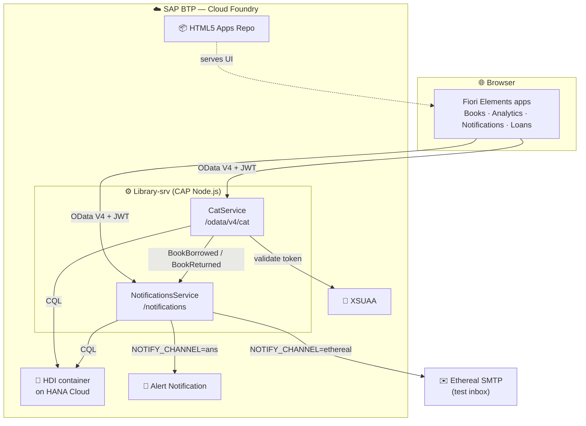
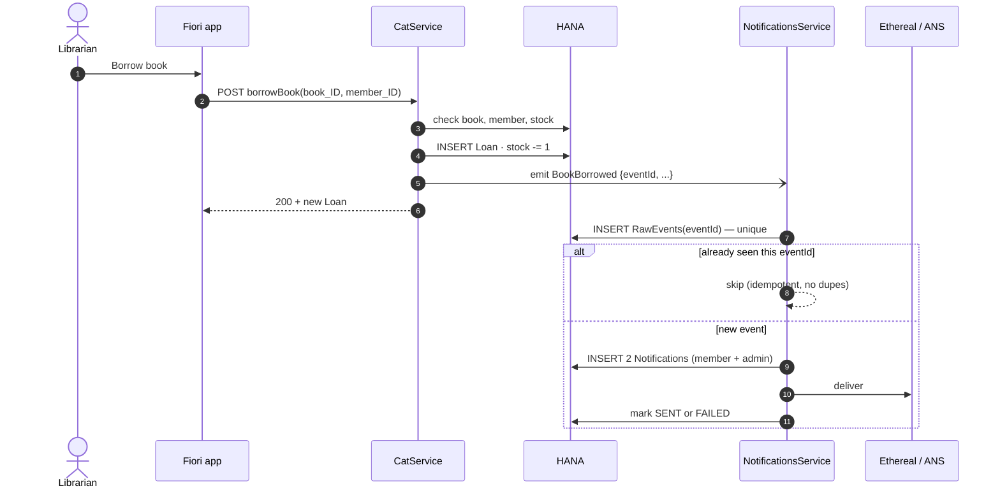
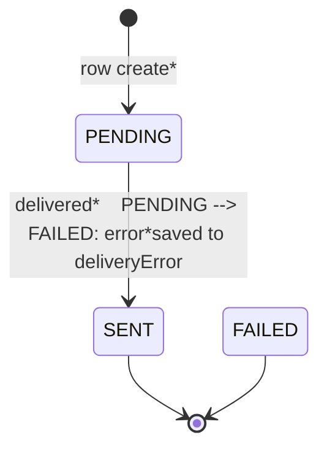

<div align="center">

# 📚 Library

### I built every layer of SAP BTP so you don't have to guess if I know it

**Data model → OData API → business logic → events → Fiori UI → HANA → auth → Cloud Foundry**
<br/>One repo. One dev. Zero tutorial copy-paste.

[](https://cap.cloud.sap)
[](https://www.odata.org)
https://img.shields.io/badge/Fiori%20Elements-V4-green?style=for-the-badge](https://experience.sap.com/fiori-design)
https://img.shields.io/badge/HANA%20Cloud-HDI-red?style=for-the-badge](https://www.sap.com/products/hana.html)
[](https://www.sap.com/products/technology-platform.html)

#-ok-so-what-is-this · #️-how-its-wired · #-the-borrow-flow-end-to-end · #️-the-data-model · #-design-calls-id-defend · #-run-it · #️-keeping-it-

</div>

---

## 🎯 ok so what is this

It's a library app. Sounds basic. It's not.

- **Librarians** run the catalog: restock, drop time-boxed discounts, log borrows and returns.
- **Every borrow/return fires an event.** A separate service catches it and sends notifications (in-app + email). The catalog has no idea notifications even exist. That's the point.
- **Analysts** get a stock-by-genre dashboard.
- **~1,000 real books, 592 real authors**, with real titles, prices, genres and cover art. No `Book 1`, `Book 2` energy here.

> [!TIP]
> No BTP account? No problem. The whole thing runs on your laptop in 5 minutes — jump to #-run-it.

**Why tho?** I'm a SAPUI5/Fiori dev. I was tired of only knowing the UI layer, so I built everything underneath it myself.

---

## 🏗️ how it's wired



**tl;dr**
- The UI talks **OData V4** to one CAP app running two services.
- No valid **XSUAA** token = no entry (401).
- **CatService** owns the catalog and lending, and fires events.
- **NotificationsService** catches them, writes notification rows, delivers them. One env var picks the channel.
- Data lives in a **HANA HDI container**. Locally it's in-memory SQLite, same code.

| Layer | Stack | What it actually does |
|---|---|---|
| **Data** | CDS on HANA Cloud (HDI) | Catalog, pricing, lending + a separate notifications domain |
| **API** | OData V4 via CAP | CRUD for free, plus bound/unbound actions and read-only functions |
| **Logic** | CAP Node.js handlers | Validation, discounts, `effectivePrice`, borrow/return rules |
| **Events** | CAP emit / subscribe | Idempotent consumer, fan-out, delivery tracking |
| **UI** | Fiori Elements (List Report, Object Page, ALP) | Annotation-driven: cover images, actions, stock-by-genre chart |
| **Auth** | XSUAA | Token-checked API, Viewer/Admin roles |
| **Delivery** | Nodemailer + SAP Alert Notification | One env var flips test inbox ↔ real alerting |
| **Deploy** | MTA → Cloud Foundry | One `mta.yaml`, one command, every service created |
| **Integration** | SAP Integration Suite (CPI) | Book Enricher iFlow: HTTPS → Request-Reply → external books API (standalone) |

---

## 🔄 the borrow flow, end to end

This is the part I'm proudest of. One click in the UI, and here's everything that happens:



Every notification tracks its own delivery, so nothing fails silently:



---

## 🗂️ the data model*
```mermaid
erDi*gram
    AUTHORS ||--o{ BOOKS : wr*tes*    AUTHORS ||--o* PROFILES : has
    BOOKS ||--o{ D*SCOUNTS : "time-boxed"
    B*OKS ||--o{ BOOK_T*GS : tagged
    BOOK* ||--o{ B*OK_CATEGORIES : in
    CATEGORIES *|--o{ B*OK_CATEGORIES : gro*ps
    MEMBERS ||--o{ LOANS :*borrows
    BOOKS ||--o{*LOANS : "l*nt out"
    RAW_EVENTS ||--o{ NOTI*ICATIONS : produces
    MEMBER* ||--o{ NOTIFICATION* : receives
    BOOKS ||--o{ NOTIF*CAT*ONS : about
```

Two namespaces: `*mart*library` (catalog, pricing, lendin*) and `smart.notifications` (event* +*notifications). Built with reusabl* aspects (`cuid`, `managed`*, custom types, enums, composition*, a calculated `*vailability` field, and read-only *oin*views.

---

## 🧠 design calls I'* defend

- **Disc*unts never touch `Books.price`.** *wn rows, own*validity window. Reversible, audit*ble, no "20* twice = 36% off" bug. `effectiveP*ice` is computed at read time, alw*ys right for **oday*. Trade-off: N+1 que*ies. Fine at this scale; batching *s the prod move.
- **Events over*direct calls.** `borrowBook` just *nnounces what happened. Scale or s*ap either side without touching th* other.
- **Idempotency built in, *ot vibes.***Unique `eventId` per event + uniqu* constraint on `R*wEvents.eventId` = redelivered eve*ts get*skipped.
- **Fan-out + delivery st*tus.** One event → member row + ad*in row, each `PENDING → SENT /*FAILED`.
- **`NOTIFY*CHANNEL` switch.** Free test inbox*locally, SA* Alert Notification on BTP.*Same code.
- **`req.params.at(-1*` for bound actions.** Works throu*h navigation pa*hs like `Authors(..)/books(..)/res*ock`*
- **Data lives in Git.** BTP tria* wipes itself.*Clone + deploy = full catalog back*
- **Services decl*red in `mta.yaml`, never by*hand.** One source of truth, z*ro name clashes.

---

## 🚀 run i**
### Local — 5 min*```bash
git clone https://github.com/dhruv37502005/Library.git
cd Lib*ary
npm install
npx cds watch
```
*pen `http://localhost:4004`. CSVs *oad into in-memory SQLite. Done.

*## Ship it to BTP
```bash
cf login*-a https://api.cf.<region>.hana.*ndemand.com --sso
mbt build
cf dep*oy mta_archives/Library_*.mtar
```

> [!IMPORTANT]
> `mta.yaml` creates every service (XSUAA, HDI, HTML5 repo, ANS, destination, connectivity). Don't `cf create-service` anything by hand, and make sure your HANA Cloud instance is running and mapped to your CF space first.

<details>
<summary>📁 <b>repo map</b></summary>

```text
Library/
├── app/
│   ├── list_object_library/      # Books — List Report + Object Page
│   ├── library-analytics/        # Analytical List Page
│   ├── notifications-ui/         # Notifications + mark-as-read
│   ├── loan-management/          # Loans — borrow/return
│   └── library-overview/         # OVP — kept as a dead end on purpose
├── db/
│   ├── schema.cds
│   ├── notifications-schema.cds
│   └── data/                     # CSV seed data
├── srv/
│   ├── cat-service.cds / .js
│   ├── cat-service-ui.cds        # Fiori annotations
│   ├── notification-service.cds / .js
│   └── lib/                      # mailer.js, ans-client.js
├── docs/
├── mta.yaml
└── xs-security.json
```
</details>

---

## ⚠️ keeping it 💯

<details>
<summary>🍳 <b>still cooking</b></summary>

- Opening the UIs *on BTP* needs SAP Work Zone (wants IAS on trial) or an app router. Locally everything runs.
- SAP Alert Notification is bound and proven from the cockpit; end to end from a CAP handler isn't verified yet.
- Events are in-process. Persistent outbox / Event Mesh is next.
- No automated tests yet. Big L, on the list.
</details>

<details>
<summary>🐛 <b>bugs I found in my own code</b></summary>

<!-- AUTHOR: delete every line you've already fixed and pushed. -->
- `restock` with an unknown book ID throws a 500, not a clean 404 (`req.error` doesn't stop execution — needs `return req.reject`).
- `getExpensiveBooks` has a hardcoded threshold above every price in the catalog, so it returns nothing.
- `BookReturned` gets logged as `BookBorrowed`, and return notifications skip `NOTIFY_CHANNEL`.
- Seed data: a few orphaned `BookCategories` rows, ~11 future publish dates, empty author `country`.
</details>

<details>
<summary>💀 <b>dead ends that taught me the most</b></summary>

- **Overview Page is OData V2 only.** On V4 it breaks. Kept `library-overview` as the receipt.
- **Analytical List Page on V4** needs `@Aggregation.ApplySupported` + dynamic measures, or the chart is empty.
- **Managed Work Zone needs IAS + OIDC trust** — not on trial by default.
- **CPI got rate-limited (HTTP 429)** because the tenant shares one outbound IP. Platform reality, not a config bug.
- **Joule-generated UIs** land at around 65%. Always review the annotations.
</details>

---

## 🗺️ what's next

- [ ] Close the bugs above
- [ ] Persistent outbox → SAP Event Mesh
- [ ] Tool-calling AI agent (Gemini free tier) that answers questions by calling CatService over OData
- [ ] Automated tests

---

<div align="center">

**Built by Dhruv Rathore**

A SAPUI5/Fiori dev who wanted to understand everything underneath the UI —
so I built every layer myself. Every decision here is one I can explain and defend.
<br/>**Ask me about any line.**

<sub>📜 MIT · Data: Best Books Ever public dataset · Patterns: SAP CAP docs</sub>

</div>