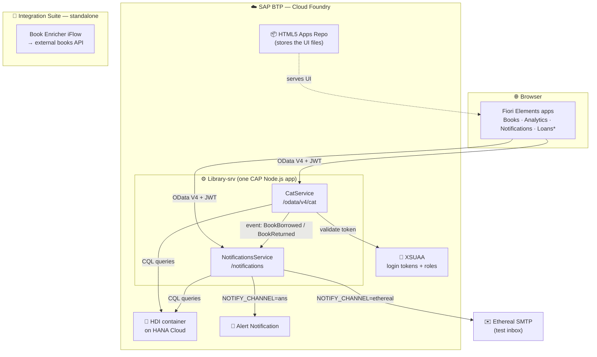
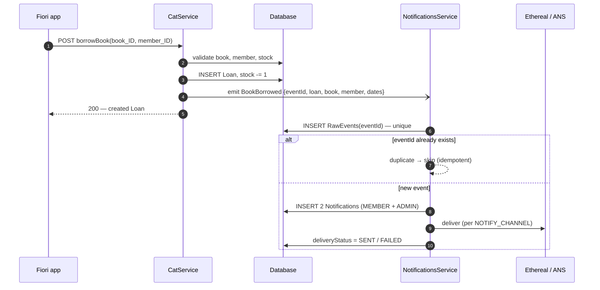

# 02 — Architecture

This document explains **how the Library project is built, layer by layer**, and **why** each choice was made.
You don't need SAP experience to follow it: every SAP term is explained the first time it appears.

> **Reading order:** §1 gives the 30-second picture. §2 walks through each layer. §3 traces real requests end to end. §4 explains the design decisions. §5 lists what is *not* built yet.

<!--
  ⚠️ AUTHOR CHECKLIST — verify before publishing, then delete this comment:
  [ ] §2.6 Security: does srv/ contain @requires / @restrict?  (grep -rn "@requires\|@restrict" srv)
      If NOT, keep the "not yet enforced" wording. If YES, switch to the "enforced" wording.
  [ ] §2.1 loan-management: still missing from `cf html5-list`? Keep "local only" if so.
  [ ] §2.5 Mail/ANS client file paths (srv/lib/...) match the repo.
  [ ] §2.8 CPI target API: Google Books (429) or switched to Open Library?
-->

---

## 1. The big picture

**What it is:** a library management system. Staff manage books, authors, stock and discounts; members borrow and return books; every borrow/return automatically produces notifications (in-app records + email).

**How it is built:** one repository (a *monorepo*) containing the database model, the backend services and several web UIs, all built with **SAP CAP** and deployed together to **SAP BTP**.

| Plain-English term | SAP name | What it means here |
|---|---|---|
| Backend framework | **CAP** (Cloud Application Programming Model) | Node.js framework: you describe data in CDS, CAP generates the database tables and the REST/OData API |
| Data-modelling language | **CDS** (Core Data Services) | `.cds` files that define entities (tables), relations and services |
| API protocol | **OData V4** | A REST standard with built-in filtering, sorting, paging and metadata. The UIs read this metadata to draw themselves |
| UI framework | **Fiori Elements** / **SAPUI5** | Apps generated from annotations: you describe *what* to show, the framework renders the screen |
| Cloud platform | **SAP BTP**, **Cloud Foundry** (CF) | SAP's cloud; CF is the runtime that hosts the Node.js app |
| Database | **SAP HANA Cloud**, **HDI container** | HANA is the database; an HDI container is an isolated schema owned by this app |
| Login & roles | **XSUAA** | BTP's OAuth2 server: issues login tokens (JWT) and defines roles |
| Deployment package | **MTA** (Multi-Target Application) | One `mta.yaml` describing every app + cloud service; one command deploys all of it |
| Email/alert service | **ANS** (Alert Notification Service) | BTP service that routes alerts to email and other channels |
| Integration platform | **CPI** (Cloud Platform Integration) | SAP's tool for connecting systems via visual "iFlows" |

### 1.1 System overview



\* Loans app runs locally; see §5.
CPI is **not connected** to the CAP app — it is a separate integration exercise (§2.8).

---

## 2. Layer by layer

The system has eight layers. Each one has a single job and talks only to its neighbours.

```
┌──────────────────────────────────────────────┐
│ 2.1 Presentation   Fiori Elements apps       │  what the user sees
├──────────────────────────────────────────────┤
│ 2.2 API            OData V4 services          │  what the UI calls
├──────────────────────────────────────────────┤
│ 2.3 Business logic JS handlers                │  rules & validation
├──────────────────────────────────────────────┤
│ 2.4 Domain model   CDS entities & types       │  what the data *is*
├──────────────────────────────────────────────┤
│ 2.5 Events         emit → consume → deliver   │  side-effects, decoupled
├──────────────────────────────────────────────┤
│ 2.6 Security       XSUAA, roles               │  who may do what
├──────────────────────────────────────────────┤
│ 2.7 Persistence    SQLite (local) / HANA (CF) │  where data lives
├──────────────────────────────────────────────┤
│ 2.8 Deployment &   MTA, Cloud Foundry,        │  how it gets to the cloud
│     Integration    CPI (standalone)           │
└──────────────────────────────────────────────┘
```

### 2.1 Presentation layer — Fiori Elements apps (`app/`)

The UIs are **generated from annotations**, not hand-coded. Annotations (in `srv/cat-service-ui.cds`) say things like "show `title`, `author`, `genre` as table columns" or "render `coverImageUrl` as an image"; Fiori Elements reads them from the OData metadata and builds the screen.

| App | Folder | Floorplan | What it shows |
|---|---|---|---|
| Books | `app/list_object_library` | List Report + Object Page | Searchable book table with cover thumbnails; detail page with cover image, effective price, `restock` / `applyDiscount` buttons |
| Analytics | `app/library-analytics` | Analytical List Page (ALP) | Stock-by-genre chart + table, driven by aggregation annotations |
| Notifications | `app/notifications-ui` | List Report | Notification rows, delivery status, mark-as-read action |
| Loans | `app/loan-management` | List Report + Object Page | Borrow/return records. **Runs locally; CF deploy config pending** |
| Overview | `app/library-overview` | Overview Page (OVP) | **Kept on purpose as a documented dead end** — OVP needs OData V2, this service is V4 |

**Why annotation-driven:** the UI stays consistent with SAP design guidelines and changes to the data model show up in the UI with little or no UI code.

**How the UI is served**
- **Locally:** `cds watch` serves the apps and the API from one Node.js process.
- **On BTP:** the built apps are uploaded to the **HTML5 Apps Repository**. Opening them from a browser additionally needs SAP Work Zone or an app router, which is not set up on the trial (§5).

### 2.2 API layer — OData V4 services (`srv/*.cds`)

Two services are exposed by the same Node.js app.

**`CatService`** — `/odata/v4/cat` — the main catalog & lending API

| Kind | Name | What it does |
|---|---|---|
| Entities | `Books`, `Authors`, `Profiles`, `Categories`, `BookCategories`, `BookTags`, `Discounts`, `Members`, `Loans`, `BooksWithAuthor` (read-only view) | Standard create/read/update/delete via OData |
| Bound action | `Books(<id>)/restock(quantity)` | Adds stock to one book |
| Bound action | `Books(<id>)/applyDiscount(percentage, startDate, endDate)` | Creates a time-bound discount row (0.01–50 %) |
| Unbound action | `borrowBook(book_ID, member_ID)` | Creates a loan, decrements stock, **emits `BookBorrowed`** |
| Unbound action | `returnBook(loan_ID)` | Closes a loan, restores stock, **emits `BookReturned`** |
| Unbound action | `resetAllStock()` | Sets all stock to 0 (admin/demo utility) |
| Functions | `getTotalBooks()`, `getExpensiveBooks()`, `getBookCountByGenre()` | Read-only queries; callable with HTTP GET |

**`NotificationsService`** — `/notifications` — read model for notifications, plus the mark-as-read action used by the Notifications app.

**Action vs function:** OData *functions* must not change data and can be called with GET (browser-testable). *Actions* change data and require POST. The split here follows that rule strictly.

### 2.3 Business logic layer — handlers (`srv/*.js`)

CAP handles plain CRUD automatically. Custom JavaScript handlers are only written where there are real rules.

| Handler | Rule it enforces |
|---|---|
| `before CREATE Books` | Price and stock cannot be negative |
| `on restock` | Book must exist; stock may not go below zero |
| `on applyDiscount` | 0.01 ≤ percentage ≤ 50; both dates required; `endDate ≥ startDate`; book must exist |
| `after READ Books` | Computes the **virtual field `effectivePrice`**: base price minus the best discount active *today* |
| `on borrowBook` | Book & member exist; stock > 0; due date = today + 14 days; emits event |
| `on returnBook` | Loan exists and is not already returned; computes `wasOverdue`; emits event |

**Notable decisions**
- **Discounts never overwrite `Books.price`.** They live in their own `Discounts` table with a validity window. This keeps the base price as the single source of truth, makes discounts reversible and auditable, and prevents "20 % twice = 36 % off" stacking bugs.
- **`effectivePrice` is computed at read time** (`after READ`), not stored, so it is always correct for today's date. Trade-off: one extra query per book row (an N+1 pattern) — acceptable at this scale, noted for batching in production.
- **Bound actions read the key with `req.params.at(-1).ID`.** This still works when the action is called through a navigation path (e.g. `Authors(..)/books(..)/restock`), where `req.params[0]` would be the author.

### 2.4 Domain model layer — CDS (`db/`)

**`db/schema.cds`** — namespace `smart.library`

| Group | Entities | Notes |
|---|---|---|
| Catalog | `Books`, `Authors`, `Profiles` | Author **composes** books and profile (child rows belong to the author) |
| Classification | `Categories`, `BookCategories`, `BookTags` | Many-to-many via a junction entity |
| Pricing | `Discounts` | Time-bound, linked to a book |
| Context `Lending` | `Members`, `Loans` | Borrowing domain; `returnDate = null` means the book is still out |
| Context `Sales` | `Orders` | Small sales stub |
| Views | `BooksView`, `BooksWithAuthor` | Read-only joins of Books + Authors |

**`db/notifications-schema.cds`** — namespace `smart.notifications`

| Entity | Purpose |
|---|---|
| `RawEvents` | Immutable log of every received event. `eventId` is **unique** → this is the idempotency guard |
| `Notifications` | User-facing rows derived from events (one per recipient), with read state and delivery status |

**Modelling features used:** reusable aspects (`cuid` = UUID key, `managed` = created/modified by/at), custom types (`Price`, `BusinessID`, `GenreType`), enums (`BookStatus`, `RecipientType`, `DeliveryStatus`, membership type), a structured type (`Address`), a calculated element (`availability` = "Available" / "Out of Stock" via a CDS `case`), and analytics annotations (`@Aggregation.ApplySupported`, `@Analytics.AggregatedProperty`) that power the ALP chart.

### 2.5 Event layer — decoupled notifications

When a book is borrowed or returned, the catalog service should **not** need to know how notifications work. So it only announces *that something happened*; a separate service reacts.



| Concept | How it is implemented | Why |
|---|---|---|
| **Publish/subscribe** | `this.emit('BookBorrowed', …)` in CatService; NotificationsService subscribes | Catalog code stays free of email/alert logic |
| **Idempotency** | Each event carries its own `eventId`; `RawEvents.eventId` is unique, so a re-delivered event is detected and skipped | Events can be delivered twice; users must not get duplicate notifications |
| **Fan-out** | One event → one `MEMBER` row + one `ADMIN` row | Different audiences, different messages |
| **Delivery tracking** | `deliveryStatus` PENDING → SENT / FAILED, with `deliveryError` | Failures are visible and retryable instead of silently lost |
| **Channel switch** | `NOTIFY_CHANNEL` env var: `ethereal`, `ans` or `both` | Same code works locally (Ethereal test inbox) and on BTP (ANS) |

**Current transport:** CAP's **in-process** event mechanism — both services run in the same Node.js process. A persistent outbox and a real message broker (SAP Event Mesh) are planned (§5).

### 2.6 Security layer — XSUAA

| Piece | Where | What it does |
|---|---|---|
| Auth strategy | `package.json` → `cds.requires.auth: "xsuaa"` (production) | Every request on BTP must carry a valid JWT from XSUAA |
| Scopes & roles | `xs-security.json` | Scopes `Viewer`, `Admin` → role templates → role collections `Library_Viewer`, `Library_Admin` |
| Instance | `mta.yaml` resource `Library-auth` | Created on deploy from `xs-security.json` |
| Local dev | CAP mocked auth | No BTP login needed with `cds watch` |

**Verified:** an anonymous call to the deployed service returns **401 Unauthorized**.

<!-- Pick ONE of the two paragraphs below, delete the other. -->

**Role enforcement — current state:** the roles are defined and deployed, but the service model does **not yet** declare `@requires` / `@restrict`. So today the system checks *that* you are logged in, not *which* role you have. Adding role checks is the next planned change (§5).

<!--
**Role enforcement:** `@requires: 'authenticated-user'` on the service, `@restrict` on entities (Viewer = read, Admin = write) and Admin-only `@requires` on mutating actions.
-->

### 2.7 Persistence layer — SQLite locally, HANA on BTP

| Environment | Database | How it is filled |
|---|---|---|
| Local (`cds watch`) | SQLite (in memory) | CSV files in `db/data/` loaded automatically at startup |
| BTP | HANA Cloud, HDI container `Library-db` | `Library-db-deployer` module runs once per deploy, creates tables and loads the same CSVs |

**Seed data:** about **1,000 real books and 592 authors** from the *Best Books Ever* public dataset, reshaped into the CDS column layout, with foreign keys checked. Dependent tables (discounts, loans, tags…) start empty so there are no orphaned references.

**Why CSV seeding:** the trial account is wiped regularly. Because the data lives in Git, a fresh clone + deploy rebuilds the full catalog with no manual import.

### 2.8 Deployment & integration layer

**MTA (`mta.yaml`)** — one file, one command (`mbt build` → `cf deploy`):

| Module / resource | Type | Purpose |
|---|---|---|
| `Library-srv` | Node.js app | Runs CatService + NotificationsService |
| `Library-db-deployer` | HDI deployer | Creates tables + loads CSVs, then stops |
| `Library-app-content` + 5 `html5` modules | UI content | Builds each Fiori app into a zip and uploads it to the HTML5 repo |
| `Library-auth` | XSUAA | Login + roles |
| `Library-db` | HDI container | The app's database schema |
| `Library-ans` | Alert Notification | Bound to `Library-srv` |
| `Library-connectivity`, `Library-destination-service` | BTP services | Outbound connectivity / destinations |
| `Library-html5-service` | HTML5 apps repo | Stores the UIs |

**CPI (Integration Suite) — standalone.** Two iFlows were built:
- **Hello CPI:** HTTPS in → Content Modifier → JSON response. Proves the tenant set-up.
- **Book Enricher:** HTTPS in → Request-Reply → HTTP call to an external books API. Structurally complete; the external API rate-limited the tenant's shared outbound IP (HTTP 429).

The CAP app does **not** call CPI today. Wiring the two together is planned (§5).

---

## 3. End-to-end request flows

**A. A user opens the Books app**
1. The browser loads the Books app and requests `GET /odata/v4/cat/$metadata`, then `GET /odata/v4/cat/Books?$top=30…`.
2. On BTP, the JWT is validated against XSUAA (no token → 401).
3. CAP turns the OData query into SQL and reads from HANA (or SQLite locally).
4. The `after READ` handler adds `effectivePrice` to each row.
5. Fiori Elements renders the table, using the annotations to show the cover thumbnail, title, author and genre.

**B. Staff applies a discount**
1. Object Page → "Apply Discount" → `POST Books(<id>)/CatService.applyDiscount` with `{percentage, startDate, endDate}`.
2. The handler validates the range, the dates and that the book exists, then inserts a `Discounts` row.
3. The next read of that book shows the new `effectivePrice` while the discount is active.

**C. A member borrows a book** — see the sequence diagram in §2.5.

---

## 4. Design decisions (and why)

| Decision | Alternative considered | Why this one |
|---|---|---|
| Monorepo (DB, services, UIs together) | Separate repos | One clone, one deploy, shared model; simpler for a single developer |
| CAP Node.js | CAP Java / ABAP RAP | Fastest feedback loop; same language as the UI tooling |
| OData V4 | OData V2 | Current standard for new Fiori Elements apps. Cost: OVP (V2-only) does not work → kept as a documented dead end |
| Annotation-driven Fiori Elements | Freestyle SAPUI5 | Consistent SAP UX with very little UI code |
| Discounts as separate rows | Overwrite `Books.price` | Reversible, auditable, no compounding |
| `effectivePrice` computed on read | Stored column | Always correct for today; accepted N+1 cost at this scale |
| Events for notifications | Call notification code directly | Catalog logic stays independent; notifications can move to their own app later |
| `eventId` uniqueness for idempotency | Trust single delivery | Message systems can deliver twice |
| `NOTIFY_CHANNEL` switch | Hard-code one channel | Free local testing (Ethereal) and real BTP delivery (ANS) from the same code |
| CSV seeding from Git | Import via CPI or manual load | Reproducible after every trial reset; CPI reserved for live integrations |
| Services declared in `mta.yaml` | Created by hand with `cf create-service` | One source of truth; avoids name clashes and duplicate instances |

---

## 5. What is not built yet

| Item | Status |
|---|---|
| Role enforcement (`@requires` / `@restrict`) | Roles defined; checks not yet in the model |
| Opening the UIs from BTP | Needs Work Zone (requires IAS on trial) or an app router |
| Loans app on BTP | Runs locally; deploy config (`ui5-deploy.yaml` + zipper) pending |
| ANS triggered from CAP | ANS bound and proven from the cockpit; end-to-end from a CAP handler not yet verified |
| Persistent outbox / Event Mesh | In-process events today |
| CPI ↔ CAP integration | iFlows run standalone |
| Automated tests | None yet |
| Tool-calling AI agent (`agent/`) | Built (Gemini, calls CatService over HTTP); not yet run end to end |

Full detail and reasoning: [Known limitations](06-known-limitations.md).
